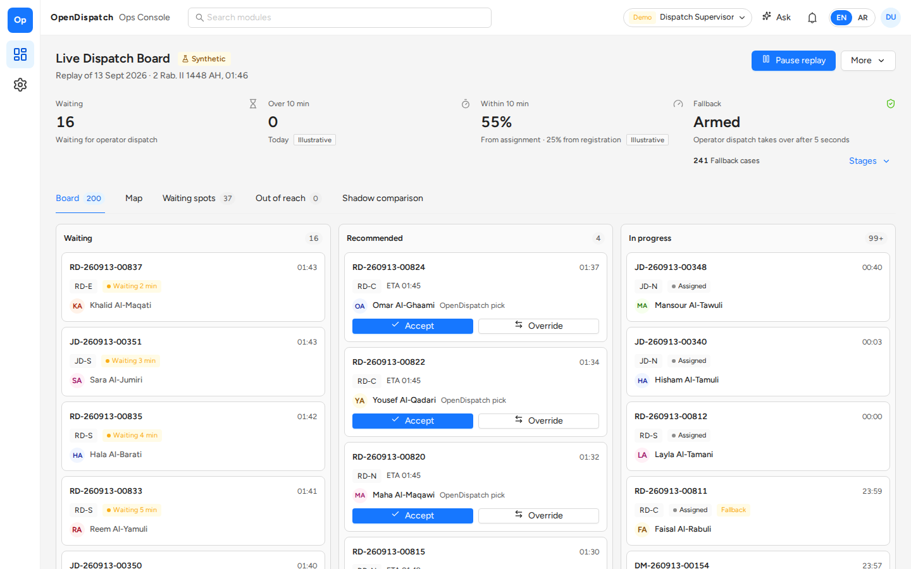
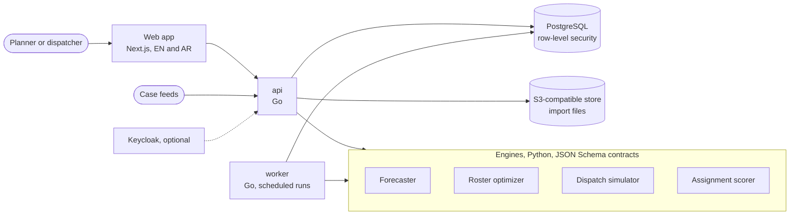
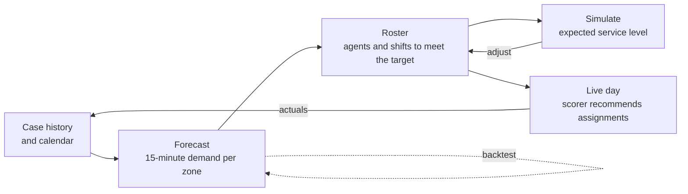
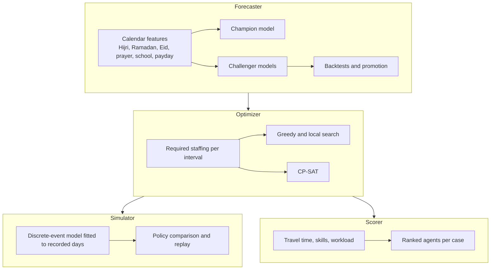
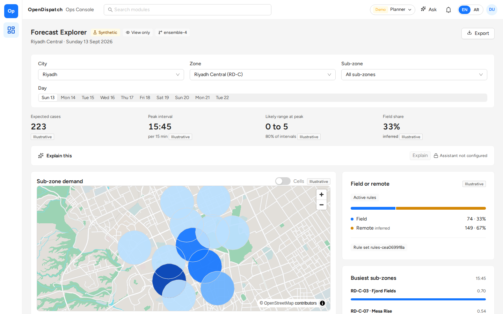
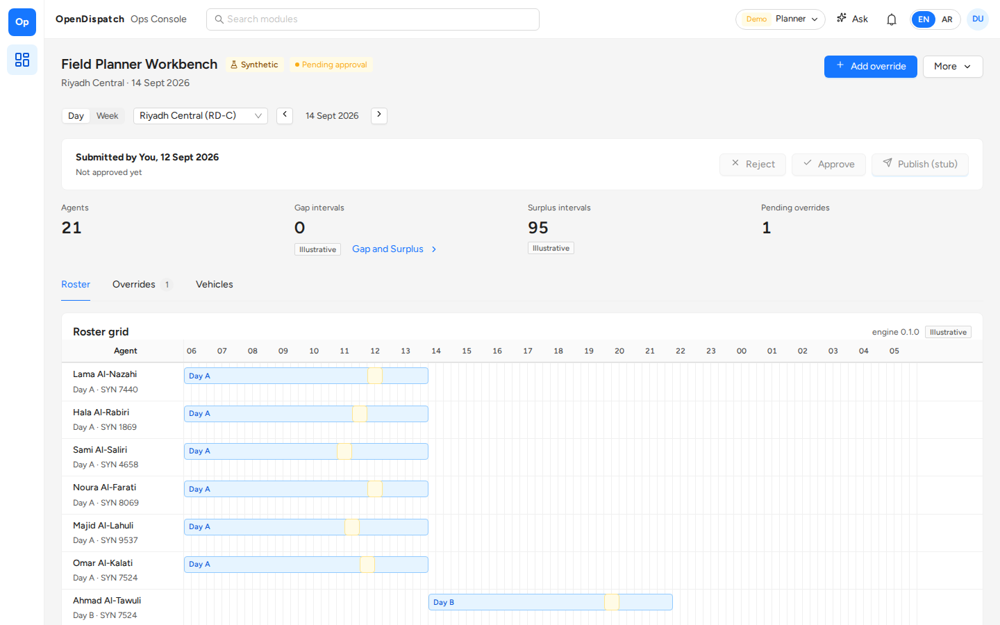
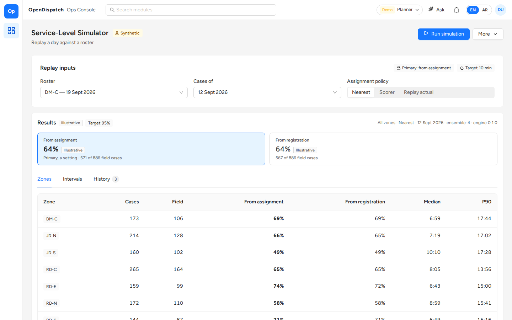
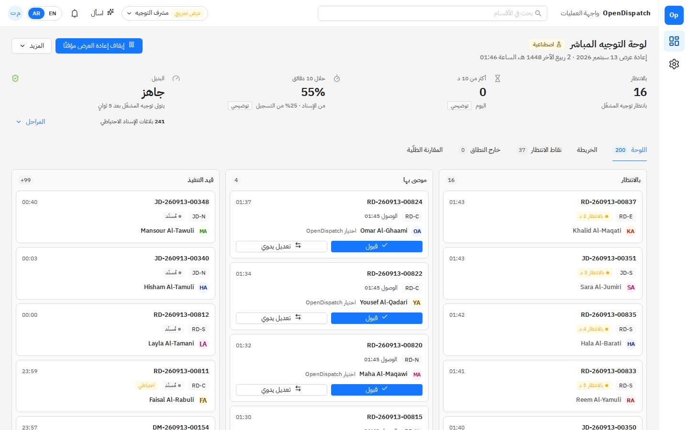

# OpenDispatch

Open-source demand forecasting and field-crew dispatch: forecast how many jobs each zone will get in every
15 minutes, build the rosters to meet a response-time target, simulate the service level, and recommend who
to send.

[](https://github.com/theomni-labs/opendispatch/actions/workflows/ci.yml)
[](LICENSE)
[](https://github.com/theomni-labs/opendispatch/releases)



OpenDispatch is built for operations that send people to incidents across a city: roadside assistance,
inspections, utilities and field service. It runs in English and Arabic, understands the Gulf
working calendar (Hijri dates, prayer times, Ramadan and Eid), and runs fully offline in your own
infrastructure. Everything in this repository, including the demo, uses synthetic data.

## Quick start

You need Docker with Compose v2.

```sh
git clone https://github.com/theomni-labs/opendispatch.git && cd opendispatch
docker compose up --build
```

Open http://127.0.0.1:3000 and pick a role: Planner for the planning screens, Dispatch supervisor for the
live board. The first build takes several minutes; the stack then seeds a year of synthetic history and two
weeks of past forecasts in the background. `docker compose down --volumes` removes it all again.

## What it does

- **Forecast** case demand per zone and sub-zone in 15-minute intervals, with calendar, weather and traffic
  features, prediction intervals and an explanation for each forecast. A champion model serves forecasts
  while challengers are backtested next to it.
- **Plan** rosters to the forecast with a greedy and local search model or an OR-Tools CP-SAT model:
  skills, shift patterns, breaks and prayer windows, leave, distance limits and service-level reach.
- **Simulate** a day of dispatch with a discrete-event simulator to compare policies before changing
  anything, or replay a recorded day.
- **Dispatch** with an assignment scorer that ranks field agents for each new case, in shadow or recommend
  mode. The operator's own dispatch always stays the fallback.
- **Operate** a multi-tenant system: PostgreSQL row-level security, an audit record for every change, roles
  and zone scopes, OIDC and SAML sign-in through Keycloak, and a CSV import with validation and rollback.

## How it fits together



The web app talks only to the api. The api and the worker own all business logic and call the engines over
HTTP with requests that match the schemas in [`contracts/engines`](contracts/engines). Each tenant's data is
isolated in PostgreSQL by row-level security, enforced on every transaction.

## The planning loop



## The engines



Each engine is a small HTTP service with a JSON Schema for its input and output, so you can run and test it
on its own. See [docs/engines.md](docs/engines.md).

## Screenshots

All screenshots are of the compose stack with synthetic data.

| Forecast explorer | Field planner |
| --- | --- |
|  |  |

| Service-level simulator | Arabic, right to left |
| --- | --- |
|  |  |

## Documentation

- [Getting started](docs/getting-started.md): the compose stack, development from source, running tests
- [Architecture](docs/architecture.md) and [data model and import format](docs/data-model.md)
- [Engines](docs/engines.md) and [the Gulf calendar](docs/gulf-calendar.md)
- [Configuration](docs/configuration.md): every environment variable
- [API](docs/api.md), [deployment](docs/deployment.md), [synthetic data](docs/synthetic-data.md), [FAQ](docs/faq.md)
- [Roadmap](ROADMAP.md): what works today and what is replay only

## Status

Version 0.1.0. The forecasting, rostering and simulation loop works end to end on synthetic data. Accuracy on
real data is not published, and live assignment has been run only in shadow and recommend modes against
simulated feeds. See the [roadmap](ROADMAP.md).

## Contributing

Issues and pull requests are welcome. Read [CONTRIBUTING.md](CONTRIBUTING.md) first: it explains the
development setup, the checks, the engineering rules and the contributor licence agreement. Please follow the
[code of conduct](CODE_OF_CONDUCT.md). Report security problems privately, see [SECURITY.md](SECURITY.md).

## Licence

OpenDispatch is licensed under the [GNU Affero General Public License v3.0 only](LICENSE). A commercial
licence is available from Omni Labs for uses the AGPL does not fit: see
[COMMERCIAL-LICENSE.md](COMMERCIAL-LICENSE.md). Third-party components and data, including OpenStreetMap
data under the ODbL, are listed in [THIRD_PARTY_NOTICES.md](THIRD_PARTY_NOTICES.md).
