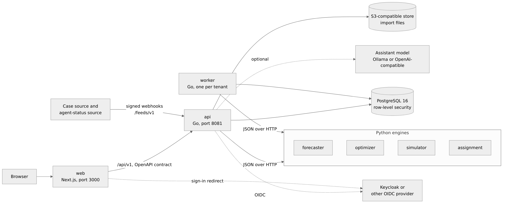
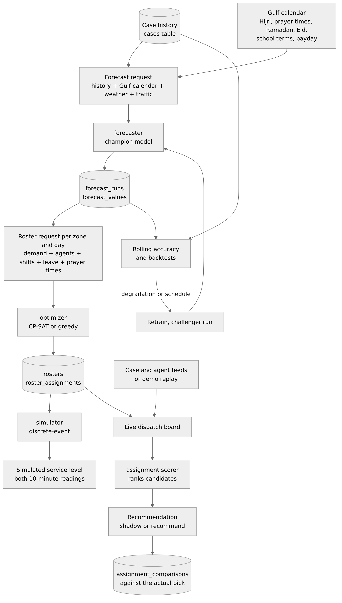

# Architecture

OpenDispatch is a monorepo with three runtimes:

- a **Next.js 16 web app** (`apps/web`) in English and Arabic, right to left for Arabic, with next-intl;
- a **Go api and worker** (`apps/api-go`) that own every read and write, the tenancy rules and the audit log;
- four **Python engines** (`engines/`) that do the numerical work behind JSON Schema contracts.

PostgreSQL holds all state. An S3-compatible store holds uploaded import files. Keycloak, or any OIDC provider,
signs users in on an install; a demo role switcher does it in evaluation.

## Services and data flow

<picture>
  <source media="(prefers-color-scheme: dark)" srcset="diagrams/architecture-1-dark.png">
  
</picture>

<sub>Diagram source: [`diagrams/architecture-1.mmd`](diagrams/architecture-1.mmd)</sub>

| Component | Code | Role |
|---|---|---|
| web | `apps/web` | Ops console (12 modules) and Admin console (18 modules). Calls only operations in `contracts/openapi.yaml`; holds no business logic and computes no figures |
| api | `apps/api-go/cmd/api` | Every operation of the contract, permission checks, tenancy, audit, inbound feeds, live dispatch board, imports, assistant |
| worker | `apps/api-go/cmd/worker` | On an interval: tomorrow's roster per zone, today's forecast, challenger runs, rolling accuracy, retrain on degradation |
| migrate | `apps/api-go/cmd/migrate` | Applies migrations with the owner role; used as a Kubernetes Job on installs |
| bootstrap | `apps/api-go/cmd/bootstrap` | First-run job: maps the first Administrator's Keycloak group to the Administrator role |
| engines | `engines/src/opendispatch_engines` | `forecaster`, `optimizer`, `simulator`, `assignment`; stateless HTTP services, one engine per process |
| demo tools | `apps/api-go/cmd/{demoseed,demohistory,demoforecasts,feedsim}`, `scripts/db`, `scripts/demo` | Seed and drive the synthetic demo; refuse to run unless `OPENDISPATCH_DEMO=1` |

### Rules the code holds to

- **Tenancy.** Every customer table has `tenant_id` and forced row-level security. The api and worker connect as an
  application role that cannot bypass it, and every transaction sets `app.tenant_id` first
  (`internal/tenancy/with_tenant.go`). The tenant comes from the signed-in session, never from request input. See
  [data model](data-model.md#tenancy).
- **Permissions.** Every operation names a module (`x-module`) and an access level (`x-required-access`). The api
  checks them on every call. See [API](api.md#permissions).
- **Audit.** Writes go through `internal/auditlog`, which records the change and its audit event in one transaction.
  The `audit_events` table is append only.
- **Numbers come from the engines.** Forecasts, rosters, simulated service levels and rankings are computed by the
  engines (or, for a few derived figures, by the api). The web app shows them; the assistant never makes them.
- **Labelled data.** Every record has `data_source` (`SYNTHETIC`, `IMPORTED` or `LIVE`). Engine outputs carry
  `illustrative: true` unless every input is real.

### Engines behind contracts

The api and worker reach the engines only through the JSON Schemas in `contracts/engines/` and the
`POST /v1/<engine>` endpoint of each container. Engines receive counts, ids and positions: never a tenant id and
never a name. With `OPENDISPATCH_ENGINE_MODE` unset (`fixture`) the api answers from `fixtures/engines/`,
so the web app runs without Python.

## The planning loop

<picture>
  <source media="(prefers-color-scheme: dark)" srcset="diagrams/architecture-2-dark.png">
  
</picture>

<sub>Diagram source: [`diagrams/architecture-2.mmd`](diagrams/architecture-2.mmd)</sub>

1. **Forecast.** The worker (or a user in Forecast and Model Admin) asks the forecaster for the planning horizon,
   7 to 30 days in 15-minute intervals per sub-zone, in pieces of at most `forecast.horizon_chunk_days`. The request
   carries case history, the [Gulf calendar](gulf-calendar.md) features of every day, and optional weather and
   traffic. The champion model answers; a challenger may run on the same request.
2. **Roster.** For each zone and day the optimizer turns the forecast into required staff per interval and assigns
   agents to shift patterns, breaks and standby points, honouring leave, vehicles, skills, Ramadan hours and prayer
   windows. Planners adjust the draft and submit it for approval.
3. **Simulate.** The simulator replays a day of cases against a roster and reports the share reached within
   10 minutes, measured from registration and from assignment.
4. **Dispatch, in shadow or recommend.** On the live board each new case gets a ranking of candidates from the
   assignment scorer. See below for what this does and does not do.
5. **Measure.** The worker stores rolling accuracy of the champion against actual cases; backtests compare the
   champion, the challenger and two baselines. A degradation, or the retraining schedule, starts a retrain.

## Live assignment: shadow and recommend, not automatic dispatch

The live board recommends; it does not dispatch. Each zone has a stage:

| Stage | What OpenDispatch does |
|---|---|
| `shadow` (default) | Ranks candidates and records what it would have picked. The source system's own assignment is shown and compared |
| `recommend` | Shows the top candidate to a dispatcher, who accepts it or overrides it with a reason. Both are audited |
| `automatic` | Defined in the contract. The board marks the case as assigned by OpenDispatch, but there is no outbound channel that sends an assignment to crews or to another dispatch system |

Whatever the stage, an assignment made by the source system is final, and when OpenDispatch has not answered in time
the case falls back to the source system's dispatch. If both feeds go quiet for longer than the fallback setting
(120 seconds by default) the board switches to fallback and says so.

The board reads either the **demo replay** (`OPENDISPATCH_DISPATCH_SOURCE=replay`, the default: a scripted synthetic
day in `fixtures/replay/`) or the **inbound feeds** (`feeds`: signed webhooks described in
`contracts/feeds.openapi.yaml`). In the Compose demo the feeds simulator sends synthetic events through the real
feed endpoints. Treat live assignment as a way to measure how a scorer would have done against real decisions,
not as a dispatch system.

## Sign-in

| Mode | `OPENDISPATCH_AUTH_MODE` | Used for |
|---|---|---|
| Demo | `demo` | Evaluation and tests. A role switcher writes a signed session cookie; no identity provider |
| OIDC | `oidc` | Installs. The api verifies tokens from the issuers in `OPENDISPATCH_OIDC_TENANTS_FILE` and maps the user's groups to a role through the tenant's group rules |

The api refuses to start without one of the two. Demo-only operations (`x-demo-only` in the contract) do not exist
in OIDC mode. Keycloak is the supported provider for installs; the Helm chart can run it (see
[deployment](deployment.md#keycloak)).

## Install modes

| Mode | Tenants per install | Identity |
|---|---|---|
| `private` | One, in the operator's own cluster | Keycloak in the install |
| `dedicated` | One, hosted for the operator | Keycloak in the install |
| `shared` | Many, separated by row-level security | One Keycloak realm, one organisation per tenant |

The install mode changes a few menus (for example, the Change Approver role exists only in private installs). See
[`apps/web/src/lib/access/README.md`](../apps/web/src/lib/access/README.md).

## Repository layout

```
apps/web/               Next.js web app, messages in apps/web/messages
apps/api-go/            Go module: cmd/* binaries, internal/* packages, migrations/
engines/                Python engines package, its Dockerfile and tests
contracts/              openapi.yaml, feeds.openapi.yaml, engines/*.schema.json, platform/update-agent.yaml
config/mappings/        import mappings: generic_csv_v1.json, traffic/traffic_v1.json
fixtures/               synthetic data written by scripts/synthetic (do not edit by hand)
scripts/                synthetic generator, contracts tooling, seed, bundle, backup, Keycloak dev tooling
deploy/compose/         helper scripts for docker-compose.yml
deploy/helm/            Helm chart and its values files
deploy/keycloak/        development realm and the login theme
e2e/                    Playwright tests
```
