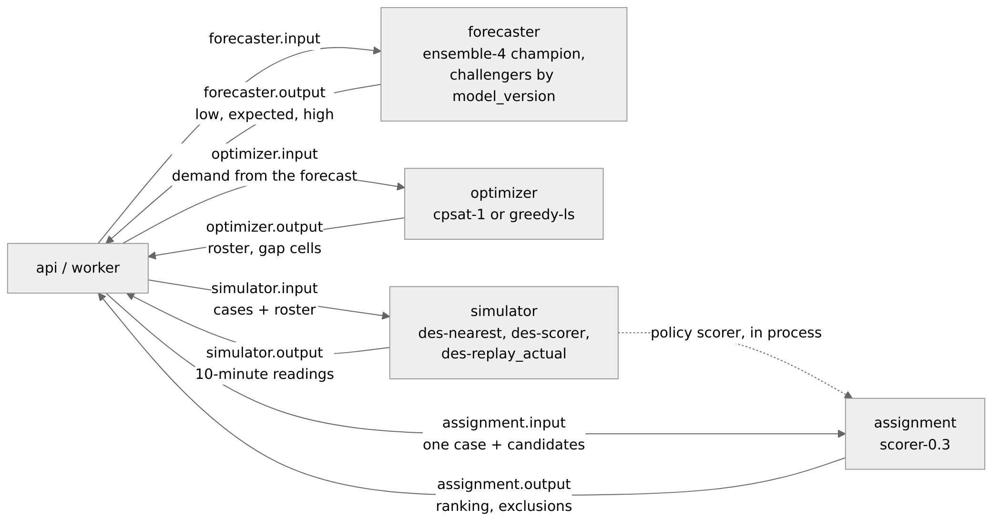

# Engines

Four engines do the numerical work. Each is a stateless Python HTTP service in `engines/`, takes one JSON request,
returns one JSON answer, and is defined by a pair of JSON Schemas in `contracts/engines/`.

| Engine | Endpoint | Contract | Answers |
|---|---|---|---|
| Forecaster | `POST /v1/forecaster` | `forecaster.{input,output}.schema.json` | Cases per sub-zone and 15-minute interval, with a range |
| Roster optimizer | `POST /v1/optimizer` | `optimizer.{input,output}.schema.json` | Shifts, breaks, vehicles and standby points per agent for one day; gaps |
| Dispatch simulator | `POST /v1/simulator` | `simulator.{input,output}.schema.json` | Service level a roster reaches on a day of cases |
| Assignment scorer | `POST /v1/assignment` | `assignment.{input,output}.schema.json` | A ranking of agents for one case |
| Idle repositioning | `POST /v1/assignment/reposition` | `reposition.{input,output}.schema.json` | Advisory waiting spots for idle agents of a zone |

<picture>
  <source media="(prefers-color-scheme: dark)" srcset="diagrams/engines-1-dark.png">
  
</picture>

<sub>Diagram source: [`diagrams/engines-1.mmd`](diagrams/engines-1.mmd)</sub>

## Common to every engine

- **Header fields.** Every request has `schema_version`, `request_id`, `requested_at` and `data_source`; optionally
  `input_data_sources` when inputs are mixed. Every answer echoes them and adds `engine` (`name`, `version`),
  `model_version`, `generated_at` and `illustrative`.
- **`illustrative`** is `true` unless `data_source` and every input source are real (`LIVE` or `IMPORTED`). On the
  synthetic data in this repository it is always `true`.
- **Deterministic.** The same request gives the same answer. Where a time budget can cut a search short, the answer
  says so (`TIME_LIMIT`) and may then depend on machine speed.
- **No tenant, no names.** Requests carry ids, counts and positions only. The engine stores nothing.
- **Unknown versus false.** An optional field left out means unknown, not false. The forecaster treats unknown
  calendar days differently from ordinary days.

## Forecaster

**Input.** `horizon` (`start_date`, `days` 1 to 30), `model` (`model_version`, `range_coverage`, default 0.8),
`zones` with their sub-zones and optional `city_id` and `region`, `calendar` (one entry per horizon day and per
history day the model needs), `history` (`records` at 15 minutes per sub-zone, optional `aggregated_records` as
hourly or daily totals for older years, optional `location_records` per micro-cell), and optional `weather` and
`traffic` per city and day. The calendar entry is described in [Gulf calendar](gulf-calendar.md#what-the-forecaster-receives).

**Output.** `values`: per sub-zone and interval, `low`, `expected`, `high`, and the split into `field_expected` and
`remote_inferred_expected` (they sum to `expected`; `low <= expected <= high`). Plus `warnings`, `model_info`
(features used, training window), optional `location_distributions` (probabilities over micro-cells per sub-zone,
hour and day group) and, from `ensemble-4`, `explanations` (per zone and day, a base level and the multipliers that
produce the expected total: weekday, trend, and each calendar or weather effect).

**Models.** `model.model_version` selects one; `forecaster/registry.py` lists them.

| Version | What it is |
|---|---|
| `ensemble-4` | Default and champion. A blend of a seasonal profile model and a calendar model (Poisson regression with day-level effects for holiday, Ramadan, payday or salary window, school periods, event types and weather), weights chosen by rolling-origin validation on the history; optional long-run model on aggregated years of history |
| `ensemble-5` | Challenger: adds days-after-Eid effects, a weekday-free shape on Eid days, and a segment-shape blend |
| `ensemble-6` | `ensemble-5`, with low-volume zones on a segment average |
| `ensemble-3`, `ensemble-2` | Earlier frozen versions, kept for comparison |
| `seasonal-profile-1` | The profile model alone: hour-of-week level, trend, 15-minute shape, prayer lull |
| `lightgbm-1`, `ets-1` | Optional models in the default image |
| `sarima-1`, `prophet-1`, `mlp-1` | Optional models, only in the `research` image |

An unknown or unavailable version never fails: the default runs and the last warning says so
(`UNKNOWN_MODEL_VERSION`, `MODEL_UNAVAILABLE`). The output's `model_version` always names the model that ran.

**Guards.** History on or after `horizon.start_date` is dropped with the warning `HISTORY_AFTER_ORIGIN`, so a request
cannot leak the days it forecasts. Weak places (low volume, no history, high validation error) are listed in
`WEAK_LOCATIONS`, not hidden.

### Champion, challenger and backtests

The api keeps two settings: `forecast.champion_model` (default `ensemble-4`), whose forecasts the plans use, and
`forecast.challenger_model` (default `lightgbm-1`), which runs on the same requests for comparison. The champion is
switched with the `switchModelVersion` operation; the challenger and the gate baseline with
`updateForecastModelSettings`. Both are audited.

A backtest replays rolling forecast origins on the stored history. For each origin the forecaster gets only history
before it and is scored at zone and hour against the cases that followed. It reports WAPE, MAPE, MAE and RMSE for
the champion, the challenger, a seasonal-naive baseline (same interval last week) and a segment-average baseline,
split by zone, hour, weekday and day type (Ramadan, Eid, holiday, payday and so on). A gate passes the engine when
its WAPE beats the gate baseline by at least `forecast.gate_min_improvement` (default 0.10) and it is worse in at
most `forecast.gate_max_worse_zones` of zones (default 0.25). Fewer than 56 days of training history gives
`not_enough_history`.

The worker also stores rolling accuracy of the champion each day; when it degrades, and `forecast.auto_retrain` is
on, it starts a retrain (a fresh champion forecast, then a backtest of champion and challenger). Every run is kept as
an experiment with its parameters, metrics and dataset snapshot.

The same harness runs from the command line, see
[`apps/api-go/internal/backtest/README.md`](../apps/api-go/internal/backtest/README.md):

```sh
cd apps/api-go
go run ./cmd/backtest -long-synthetic -forecaster engine -engine-url http://127.0.0.1:8090 \
  -models ensemble-4,ensemble-5,lightgbm-1
```

On synthetic data every figure is illustrative: the generator has known effects, so a backtest checks mechanics,
not real accuracy.

## Roster optimizer

**Input.** `roster_date`, `zone_ids`, `planning_level`, `calendar_mode` (normal or Ramadan hours), `forecast` (demand
per interval, from the forecaster), `agents` (availability, skills, eligible patterns, home zone), `vehicles`,
`shift_patterns`, `break_rules`, `prayer_times`, `standby_points`, optional `fixed_assignments`,
`scenario_adjustments` (headcount changes for what-if runs), `dispatch_centres`, `travel_model`,
`prayer_window_minutes` (5 to 90, default 30) and `objective`.

`objective` holds `demand_quantile` (expected or high), `cases_per_agent_per_interval`, `max_run_seconds` (default
20 per zone), `seed`, `model_version`, optional `skill_requirements`, `max_deploy_distance_km` and `service_level`
(a travel-time threshold and a target share of demand reached).

**Output.** `roster_assignments` (agent, shift pattern, zone, start, end, break, standby point),
`vehicle_assignments`, `gap_cells` (per interval: required, planned, delta, kind, cause, and `reach_share` with a
service level), `break_cost`, `violations`, `status` (`feasible`, `partial`, `infeasible`) and `solver_status`
(`optimal`, `feasible` or `heuristic`).

**Models.**

| Version | Method |
|---|---|
| `cpsat-1` | OR-Tools CP-SAT. Agents with the same eligible patterns are interchangeable, so variables are counts per group, pattern, break slot and standby point. Objective, lexicographic: unmet demand, then reach shortfall, then over-staffing, then breaks taken at the same time. One worker and a fixed seed; reproducible while the deterministic time limit binds first. A zone with no solution in time falls back to the greedy. The api uses this model by default |
| `greedy-ls-0.3` | Greedy construction then local search, with the distance limit and staggered breaks |
| `greedy-ls-0.2`, `greedy-ls-0.1` | Earlier greedy versions; `0.2` adds the service-level reach |

**Rules handled.** Leave, eligible patterns, one shift per agent, locked assignments, Ramadan hours, a break per shift
inside its allowed window and outside each prayer window, one vehicle per field agent, vehicle caps per zone, skills
coverage, and standby points chosen for coverage. Agents are never lent across zones. Breaks go where cover is least
short, so they fall in low-demand periods.

**Limits.** Night shifts that cross midnight count only for the part inside the roster date. No continuity across
days beyond `available`. Travel for reach is straight line with a detour factor.

## Dispatch simulator

A deterministic discrete-event simulation of one day.

**Input.** `cases` (registration time, zone, position, handling, optional recorded outcomes), `roster` (lines with
zone, shift, break and start position), `threshold_seconds` (600 for the 10-minute reading),
`clock_start_primary` (`assignment` or `registration`), `assignment_policy`, `travel_model`, `seed` and
`include_case_outcomes`.

**Policies.**

| Policy | Model version | How cases are given to agents |
|---|---|---|
| `nearest` | `des-nearest-0.3` | Least modelled travel time |
| `scorer` | `des-scorer-0.3` | The assignment scorer's top pick, called in process |
| `replay_actual` | `des-replay_actual-0.3` | The assignments recorded on the cases, in recorded order (replay of history) |

Travel is straight-line distance times a detour factor at a speed adjusted by hour and zone, plus a residual drawn
from a fitted table; agents return to their standby point after each case. Parameters are fitted from recorded days
with `python -m opendispatch_engines.simulator.calibrate`; the committed values in `simulator/fitted.py` are fitted
on synthetic days only.

**Output.** Overall, per zone and per 15-minute interval: case counts, both 10-minute readings
(`from_registration`, `from_assignment`), median and 90th percentile of registered-to-assigned, assigned-to-arrived
and registered-to-arrived, and agent utilisation. With recorded arrivals, `REPLAY_DEVIATION` warnings compare
simulated and recorded outcomes per zone.

**Limits.** No road network, one dispatch rule per run, no reassignment or cancellation, a FIFO queue per zone. It
makes no claim that one policy beats another.

## Assignment scorer

**Input.** One `case` (position, zone, case type, handling, parties, required skills, `existing_assignment_id`),
`candidates` (status, position and its age, roster zone, shift end, breaks, skills, vehicle, cases today,
`busy_until`), `now`, `stage`, `decision_deadline_ms`, `top_n`, optional `prayer_window` and `travel_model`.

**Output.** `status` (`ranked`, `no_eligible_agent`, `already_assigned`), `ranking` (rank, agent, estimated travel
seconds, arrival time, score, reason codes and an English reason) and `excluded` (agent and exclusion code:
`OFFLINE`, `ON_BREAK`, `BUSY`, `STALE_POSITION`, `MISSING_SKILL`, `NO_VEHICLE`, `OFF_SHIFT`).

**Method (`scorer-0.3`).** A cost in seconds per eligible agent: travel time, a wait for an agent about to be free,
and named penalties for leaving another zone without cover, working out of zone, workload, a shift about to end, a
break due, and, only when the request carries `prayer_window`, arriving inside it. Score is `1 / (1 + cost / 600)`.
Weights are named fields of `assignment.Weights`. The engine stops at 90% of `decision_deadline_ms` and returns what
it has, flagged `deadline_exceeded`.

**Repositioning** (`/v1/assignment/reposition`) suggests waiting spots for a zone's idle agents from expected
demand per micro-cell: a p-median choice of spots, then a minimum-cost matching of agents to spots. It never moves an
agent with a case and is advisory only.

**Limits.** No road network or live traffic, no per-case-type job length, one case at a time. It ranks; it does not
decide whether to assign. See [architecture](architecture.md#live-assignment-shadow-and-recommend-not-automatic-dispatch).

## Run an engine on its own

### From source

```sh
cd engines
python3.12 -m venv .venv && . .venv/bin/activate
pip install -r requirements/base.txt && pip install -e '.[dev]'
OPENDISPATCH_ENGINE=optimizer OPENDISPATCH_ENGINE_ADDR=127.0.0.1:8080 \
OPENDISPATCH_CONTRACTS_DIR=../contracts/engines python -m opendispatch_engines.server
```

```sh
curl -s 127.0.0.1:8080/health
curl -s -X POST 127.0.0.1:8080/v1/optimizer \
  -H 'Content-Type: application/json' -d @../contracts/engines/examples/optimizer.input.json
```

Each contract has an example request in `contracts/engines/examples/`. Bodies may be gzip-encoded.

### In Python

```python
from opendispatch_engines.forecaster import handle
answer = handle(request_dict)
```

Every engine package exposes `handle(request: dict) -> dict`.

### In a container

```sh
docker build --target engine -t opendispatch/engines:dev engines
docker run --rm --read-only --tmpfs /tmp -p 127.0.0.1:8080:8080 \
  -e OPENDISPATCH_ENGINE=simulator \
  -v "$PWD/contracts/engines:/contracts/engines:ro" opendispatch/engines:dev
```

The image has two targets: `engine` (default; numpy, scipy, LightGBM, OR-Tools) and `research` (adds statsmodels,
Prophet and CPU-only PyTorch for the research models). The container runs as user 65532.

### Server limits

The service has no authentication. On a cluster a NetworkPolicy must restrict ingress to the api and worker; the
Helm chart writes one.

| Variable | Default | Effect |
|---|---|---|
| `OPENDISPATCH_ENGINE` | none | `forecaster`, `optimizer`, `simulator` or `assignment` |
| `OPENDISPATCH_ENGINE_ADDR` | `0.0.0.0:8080` | Listen address |
| `OPENDISPATCH_CONTRACTS_DIR` | `../contracts/engines` | Where the schemas are (tests skip without them) |
| `OPENDISPATCH_ENGINE_READ_TIMEOUT` | `10` | Socket timeout in seconds |
| `OPENDISPATCH_ENGINE_MAX_CONCURRENT` | `16` | Concurrent requests; more get 503 |
| `OPENDISPATCH_ENGINE_MAX_BODY` | `16777216` | Bytes on the wire; more get 413 |
| `OPENDISPATCH_ENGINE_MAX_DECOMPRESSED` | `134217728` | Bytes after gzip decoding; more get 413 |
| `OPENDISPATCH_ENGINE_MAX_LIST` | `2000000` | Items in any one JSON list; more get 400 |
| `OPENDISPATCH_ENGINE_MAX_CONNECTIONS` | 8 times concurrent, at least 64 | Open connections; more get 503 |

Errors never echo request content, and request bodies are never logged.

## Tests

```sh
cd engines && OPENDISPATCH_CONTRACTS_DIR=../contracts/engines pytest
```

The tests check contract conformance, determinism, the history guard, leakage, and recovery of known effects from
synthetic data. Run a test file with `-s` to see its synthetic figures; they are illustrative and say nothing about
accuracy on real cases.
