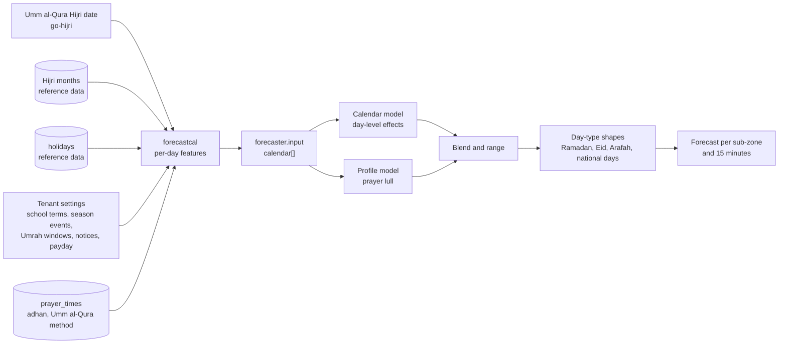

# The Gulf calendar

Demand for field crews in the Gulf follows a calendar that a Gregorian weekday model does not see. Ramadan moves
about eleven days earlier each Gregorian year and changes the shape of every day inside it. Eid empties some roads
and fills others. Activity dips around each of the five prayers. The weekend is Friday and Saturday. Salaries land
near the end of the month. OpenDispatch derives these features for every day it forecasts and sends them to the
forecaster, which learns how much each one moves demand from the case history.

The calendar says when things happen. How much they change demand is always estimated from history, never assumed.



The code is in `apps/api-go/internal/forecastcal` (features), `apps/api-go/internal/business/engine_request_loaders.go`
(building the request) and `apps/api-go/internal/backtest/daytype.go` (day-type shapes). All local times are
Asia/Riyadh (+03:00).

## Hijri dates (Umm al-Qura)

Every calendar day carries its Umm al-Qura date as `hijri_date` (`year`, `month`, `day`), computed with
[go-hijri](https://github.com/hablullah/go-hijri). The synthetic generator uses the `islamic-umalqura` calendar of
`Intl` for the same purpose.

`is_ramadan` comes from the Hijri month reference data (`fixtures/reference/hijri_months.json`, read by the api at
start and listed in Admin, Leave Policy and Calendar), which maps each Hijri month to its Gregorian start and end.
The committed file covers 2026. Dates outside it fall back to the Umm al-Qura computation, so a two-year history
still gets its Ramadan days.

## Ramadan and Eid

From the Hijri date, OpenDispatch derives these events itself:

| Event | Type sent | Hijri days |
|---|---|---|
| Eid al-Fitr | `eid` | 1 to 4 Shawwal |
| Eid al-Adha | `eid` | 10 to 13 Dhu al-Hijjah |
| Arafah Day | `hajj` | 9 Dhu al-Hijjah |
| Hajj | `hajj` | 8 to 13 Dhu al-Hijjah |
| Hajj pre-season, post-season | shown on screens only | 1 to 7 and 14 to 15 Dhu al-Hijjah |
| National Day | `national_day` | 23 September (Gregorian) |
| Founding Day | `national_day` | 22 February (Gregorian) |

How the forecaster uses them:

- **Ramadan has its own day shape.** Ramadan days are kept out of the ordinary hour-of-week levels and get their own
  24 hourly multipliers, so the late-night and pre-dawn peaks of Ramadan do not smear into the weeks after it. The
  day total gets a Ramadan effect like any other.
- **Eid and the other events are day-level effects**, one per event type, estimated against ordinary days. On an
  event day the calendar model weighs at least 0.8 in the blend, because the profile model cannot see events.
- **Day-type shapes.** After the forecast, the api spreads each zone-day's total over the day. On Ramadan days (split
  by whether school is in session), Eid day one, the other Eid days, Arafah Day and national days, the shape is that
  day type's own shape from up to three years of history, not the engine's. Setting `forecast.day_type_shapes`
  (default on) controls this.
- **Long history.** Because Hijri events move through the Gregorian year, a 12-week window rarely contains an Eid.
  With `history.aggregated_records` (hourly or daily totals for older years) the forecaster fits a long-run model
  and carries Ramadan, Eid and summer effects from earlier years into the current forecast.
- `ensemble-5` and later add separate effects for the two days after Eid and the four days after those, and drop
  the weekday pattern on Eid days.

An effect with no flagged day in the history is set to 1, the forecast warns (`NO_<TYPE>_HISTORY`), and the range of
that day is widened.

## Prayer times

Prayer times are computed with [adhan-go](https://github.com/MSA-Software-LLC/adhan-go) using the Umm al-Qura
method at each city's location, and stored in the `prayer_times` table. An administrator can recompute them; the
recompute is audited. They are used in four places:

| Where | How |
|---|---|
| Forecaster | A calendar day may carry `prayer_times` (fajr, dhuhr, asr, maghrib, isha, local `HH:MM`). The profile model estimates one lull factor for the 15-minute slot of each prayer and the slot after it, from history days that carry prayer times, and applies it to those slots. The api sends the prayer times of one city (the city of the first active zone) and only on horizon days, so in requests it builds today the lull stays at 1; a sender that adds them to history days gets the lull estimated |
| Roster optimizer | `prayer_times` and `prayer_window_minutes` (5 to 90, default 30): no break is placed inside the window after each prayer time |
| Break planner | A per-tenant policy that can line breaks up with a prayer so the break covers it |
| Assignment scorer | Optional: when the request carries `prayer_window`, arriving inside it costs `prayer_seconds`. Off unless setting `dispatch.prayer_penalty` is on |

## Weekends and the working week

The weekend is Friday and Saturday. No weekend flag is needed: the forecaster has an intercept for each day of the
week and a level for each hour of the week, so Thursday evening, Friday and Saturday are learned from the history
like any other day. Where the api groups days (segment shapes and day types), it uses four groups: Sunday to
Wednesday, Thursday, Friday, and Saturday.

## School periods

Setting `forecast.school_terms` holds the school term date ranges (`start`, `end`, `name`). Inside the span the
terms cover, each day is sent with `school_in_session` true or false. Outside it, or when the list is empty, the field
is left out: unknown, not false. OpenDispatch never fills the terms in for you.

The contract also accepts a finer `school_period` per day (semester, exams, and kinds of vacation) and
`school_period_by_region` with `zones[].region` (`central`, `western`). The forecaster uses them when present, and
they then replace `school_in_session`. The api does not fill them today; a sender that knows them can.

## Payday and the salary window

| Setting | Default | Sent as |
|---|---|---|
| `forecast.payday_day` | 27 (an assumption; set it to your market's payday; 0 turns it off) | `is_payday` on that day of each month, or the month's last day when the month is shorter. No weekend shift |
| salary window | the 25th to the month's end | `salary_window` on each of those days |

When any calendar day carries `salary_window`, the calendar model uses it and ignores `is_payday`, so the two are
never counted twice. Payday is edited in Admin, Leave Policy and Calendar, and the change is audited.

## Seasons, Umrah and announced events

| Setting | Sent as |
|---|---|
| `forecast.season_events` | `season_event` on each day of each range |
| `forecast.umrah_windows` | `umrah` on each day of each range |
| `forecast.notice_events` | Events saved from a pasted notice (a match, a festival, a road closure), with their zones and expected impact. Sent as `season_event` or `other`, scoped to their `zone_ids` |

A zone-scoped event's effect is estimated only from the zones it names, against their own ordinary days. The AI
assistant can read a pasted notice into draft events; a person saves them.

## What the forecaster receives

One `calendar` entry per day, for every horizon day and every history day the model needs:

```json
{
  "date": "2026-03-20",
  "is_holiday": true,
  "holiday_name": "Eid al-Fitr",
  "is_ramadan": false,
  "hijri_date": { "year": 1447, "month": 10, "day": 1 },
  "is_payday": false,
  "salary_window": false,
  "school_in_session": false,
  "events": [{ "type": "eid", "name": "Eid al-Fitr" }],
  "prayer_times": { "fajr": "04:46", "dhuhr": "12:10", "asr": "15:34", "maghrib": "18:15", "isha": "19:45" }
}
```

The values above are an invented illustration of the shape. `is_holiday` and `holiday_name` come from the
`holidays` reference table. `events` is always sent, `[]` on a day with none, because an absent list means unknown.
At most 8 events are sent per day. The full schema is `calendar` in `contracts/engines/forecaster.input.schema.json`.

## Checking it

- Admin, Leave Policy and Calendar lists the derived events for a date range next to the settings.
- Each forecast explanation (Forecast Explorer, "Why this forecast") lists the calendar multipliers applied to a zone
  and day.
- Backtests report error by day type (Ramadan, Eid, holiday, payday and others), so you can see where the calendar
  helps and where it does not. On synthetic data these figures are illustrative.
